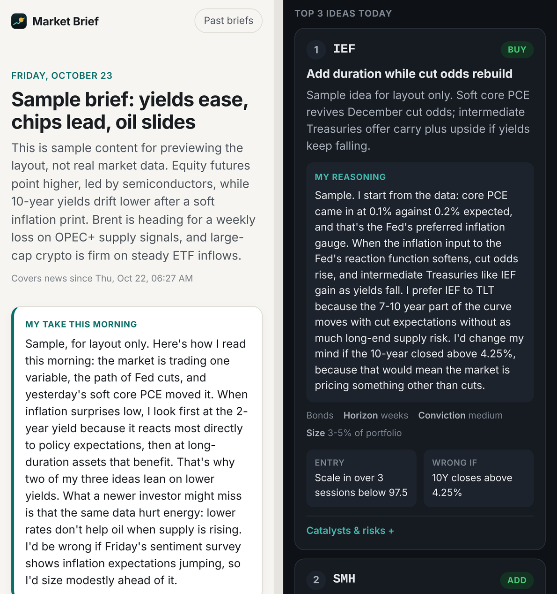

# Market Brief

A morning markets brief on your iPhone lock screen at **7:30 AM local time, wherever you are**. Every morning it:

1. collects all market news published since the previous brief (about 25 RSS and Google News feeds),
2. pulls **corporate earnings** (results reported since the last brief, plus the big reports coming up) and **economic data** (actual vs consensus vs previous, plus the week's calendar),
3. pulls prices for US equities and sectors, Treasuries and credit, Brent and WTI, gold and the dollar, and the major layer-1 crypto networks (BTC, ETH, SOL, BNB, XRP, ADA, AVAX, SUI, TON),
4. runs a short web-search pass for pre-market futures and anything the feeds missed,
5. has Claude write the brief, including:
   - **three ranked ideas**, each with entry, invalidation level, horizon and size,
   - **"My reasoning"** for each idea, explained step by step the way an instructor would,
   - **"My take this morning"**, a first-person read of the market,
   - **a lesson of the day** on one concept at work in today's market,
6. publishes it to a small web app on GitHub Pages and sends a push notification to your iPhone.



It costs nothing to run: GitHub Actions and Pages are free for public repositories, the data sources are free, and Claude runs on your existing Claude subscription (no API key, no per-use charges). There's no App Store, Xcode or Apple developer account involved either. On iPhone it installs from Safari as a Home Screen web app, which iOS 16.4 and later allows to receive notifications.

> Everything is generated automatically from public data and can be wrong. It is not personalised investment advice.

```
GitHub Actions (checks every 15 min, acts at 07:00 / 07:30 in your time zone)
  ├─ news.py      RSS + Google News since the last brief
  ├─ events.py    earnings (Nasdaq) + economic calendar (Nasdaq, ForexFactory)
  ├─ markets.py   Yahoo Finance · CoinGecko · US Treasury yield curve
  ├─ analyst.py   Claude Code on your subscription → structured brief (JSON schema)
  ├─ data/        brief committed to the repo (history + "since last" state)
  ├─ GitHub Pages web app (installable on iPhone, works offline)
  └─ notify.py    Web Push to the installed app (and/or ntfy)
        ▲
        └── the app reports the phone's time zone back (BRIEF_TIMEZONE)
```

## Set up (about 20 minutes)

### 1. Put the code on GitHub

Create a new **public** repository and push this folder to it. Public matters: it keeps GitHub Actions and Pages free. The 15-minute schedule checks would use up a private repository's free Actions minutes within a few weeks. Your tokens and push subscription stay in encrypted secrets, but the briefs themselves will be publicly readable.

### 2. Connect Claude through your subscription (free)

On any computer with Node.js 18 or later, run:

```bash
npx @anthropic-ai/claude-code setup-token
```

Sign in with your Claude account when the browser opens, then copy the token it prints (it starts with `sk-ant-oat`). In the repo go to **Settings → Secrets and variables → Actions → New repository secret**:

| Secret | Value |
|---|---|
| `CLAUDE_CODE_OAUTH_TOKEN` | the token |

The token is valid for a year. Each brief counts toward your plan's normal usage limits, the same as using Claude Code yourself; one brief a day is a small fraction of them. If your plan doesn't include Opus in Claude Code, add the variable `BRIEF_MODEL` = `claude-sonnet-5-5`.

<details>
<summary>Prefer pay-as-you-go instead?</summary>

Add the secret `ANTHROPIC_API_KEY` (from [console.anthropic.com](https://console.anthropic.com)) and leave `CLAUDE_CODE_OAUTH_TOKEN` unset. That costs roughly $0.40–0.80 per brief with Opus. If both are set, the free subscription route is used.
</details>

### 3. Create the push keys and set your starting time zone

```bash
npx web-push generate-vapid-keys
```

(or `pip install -r requirements.txt && python -m brief vapid`). Add the output to the repo, along with your current time zone. Secrets go on the **Secrets** tab and variables on the **Variables** tab of **Settings → Secrets and variables → Actions**:

| Type | Name | Value |
|---|---|---|
| Secret | `VAPID_PRIVATE_KEY` | the *Private Key* line |
| Variable | `VAPID_PUBLIC_KEY` | optional: the *Public Key* line (it's calculated from the private key anyway) |
| Variable | `VAPID_SUBJECT` | Optional, and best left out: your site's address is used. If you do set it, the whole value is `mailto:` immediately followed by your real email address, with no spaces |
| Variable | `BRIEF_TIMEZONE` | where you are now, e.g. `Asia/Singapore`, `America/New_York`, `Europe/London` |

The app keeps `BRIEF_TIMEZONE` up to date once step 7 is done.

### 4. Turn on GitHub Pages

**Settings → Pages → Build and deployment → Source: GitHub Actions.**

### 5. Run it once

**Actions → Morning brief → Run workflow.** When it finishes, the app is live at `https://<your-user>.github.io/<repo>/`. No notification goes out yet because no phone is connected; the log says so.

### 6. Install on your iPhone

1. Open the URL in **Safari** → tap **Share** → **Add to Home Screen**.
2. Open **Brief** from the Home Screen (not from Safari) → **Enable notifications** → **Allow**.
3. Tap **Copy code** and save it as the repo secret `WEB_PUSH_SUBSCRIPTIONS`.
   For several devices, paste a JSON array: `[{…iphone…}, {…ipad…}]`.
4. Run the workflow again with **Only send a test notification** ticked. A test notification should arrive within seconds.

### 7. Make it follow your time zone

The brief is sent at 7:30 in the time zone stored in the repo variable `BRIEF_TIMEZONE`. Let the app keep it current:

1. Create a [fine-grained GitHub token](https://github.com/settings/personal-access-tokens/new):
   - **Repository access:** only this repository
   - **Permissions → Repository → Variables:** Read and write (nothing else)
2. In the app, go to **Settings → Follow my time zone**, paste the token, and tap **Save and sync**.

From then on the phone reports its time zone every time a morning notification arrives and every time you open the app. Land in Tokyo, open the app (or just receive that day's brief), and the next brief comes at 7:30 Tokyo time. The token stays on the phone, and all it can do is change this repository's variables. If you'd rather not use a token, set `BRIEF_TIMEZONE` by hand (for example `Asia/Singapore`). The app reminds you when the phone and the schedule disagree.

That's it. Tap the notification to open the full brief. **Past briefs** keeps the history.

If you delete and re-add the Home Screen app, its push subscription changes: repeat step 6.3 (the workflow log says *"push subscription expired"* when that's needed).

### Option: ntfy instead of (or alongside) Web Push

Install the free [ntfy](https://ntfy.sh) iOS app, subscribe to a long random topic name (topic names on ntfy.sh are public, so make it unguessable), and add it as the secret `NTFY_TOPIC`. Tapping the notification opens the brief. Self-hosted ntfy: set the variable `NTFY_SERVER` and, if needed, the secret `NTFY_TOKEN`.

## How the 7:30 timing works

The workflow wakes every 15 minutes, all day. Each wake-up reads `BRIEF_TIMEZONE` and decides:

- **07:00 local:** prepare today's brief (news, earnings, data, prices → Claude → publish).
- **07:30 local:** send the notification.
- **Any other time:** exit in a few seconds.

The 15-minute rhythm covers every time zone, including half-hour and 45-minute offsets such as India and Nepal. GitHub sometimes starts scheduled runs a few minutes late, so expect the notification between about 7:30 and 7:45.

If preparing fails, the next check retries, up to 3 times a day, and then the app sends a "Morning brief failed" notification. A brief that finishes after 7:30 is sent straight away.

To use a different time, set the variable `BRIEF_SEND_AT` (for example `06:45`). `BRIEF_PREPARE_MINUTES` (default `30`) controls how early preparation starts.

## Tune it

All optional, set as repository **Variables**:

| Variable | Default | What it does |
|---|---|---|
| `INVESTOR_PROFILE` | moderate risk, long-only USD cash account, ETFs/stocks/spot crypto, days–months | Tailors the three ideas to you. Describe your risk tolerance, account type, holding period and what you can trade. |
| `BRIEF_MODEL` | `claude-opus-5-5` | Claude model. |
| `BRIEF_EFFORT` | `high` | How hard Claude thinks: `medium`, `high`, `xhigh`, `max`. |
| `BRIEF_WEB_RESEARCH` | `true` | `false` skips the web search pass. |
| `BRIEF_ENGINE` | `auto` | `claude-code` (subscription), `api` (API key), or `auto` (subscription if its token is set). |

Feeds, instruments and the earnings size cut-off (US$20B market cap by default) live in `brief/config.py`. A free CoinGecko demo key (secret `COINGECKO_API_KEY`) avoids crypto price rate limits.

## Data sources

All free, no keys needed: Yahoo Finance chart data, CoinGecko, the US Treasury yield curve, Nasdaq's earnings and economic-event calendars, the ForexFactory weekly calendar, Google News, and publisher RSS feeds. None of them are official APIs, so they can change. A failed source is logged and skipped, and the brief notes the gap instead of failing.

## If something goes wrong

- **No notification, but the run succeeded:** check that the app was opened from the Home Screen, and that notifications for *Brief* are on in iOS Settings. Then redo step 6.
- **Wrong time:** open the app. Settings shows the phone's time zone and the one the schedule uses.
- **Run failed:** open the run log in the Actions tab. After 3 failed attempts in a day the app also notifies you.
- **Subscription token expired** (after a year, or if you sign out everywhere): rerun step 2.
- **Scheduled runs stopped:** GitHub pauses schedules in repos with 60 days of no activity. The daily commit normally prevents this; re-enable it from the Actions tab if needed.

## Develop locally

```bash
python -m venv .venv && . .venv/bin/activate
pip install -r requirements-dev.txt
pytest                                                   # unit + integration tests, no network needed

python -m brief build-site --sample --out _site          # preview the app with a sample brief
python -m http.server -d _site 8000                      # → http://localhost:8000

python -m brief gate                                     # what would a check do right now?
CLAUDE_CODE_OAUTH_TOKEN=... python -m brief generate --print-prompt   # a real run (writes to data/)
```

| Path | |
|---|---|
| `brief/config.py` | settings, feeds, instruments |
| `brief/schedule.py` | the 07:00 / 07:30 local-time plan and state (stdlib only) |
| `brief/news.py`, `brief/events.py`, `brief/markets.py` | data collection |
| `brief/models.py` | the brief's JSON schema |
| `brief/analyst.py` | prompts, and the two engines: Claude Code (subscription) and the API |
| `brief/notify.py` | Web Push and ntfy |
| `web/` | the iPhone web app (`shared.js` holds the time zone sync) |
| `data/` | generated briefs and state (committed by the workflow) |
